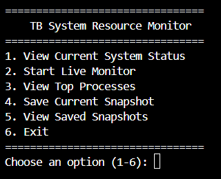

# TB System Resource Monitor
- This Python command-line application monitors CPU, memory, disk usage, and memory-consuming processes using `psutil`.
- This code displays current system status, reports resource warnings, and can refresh resource usage in a live view.
- You can save resource snapshots to `logs/snapshots.csv` and review previously saved snapshots from the menu.
- Install dependencies with `pip install -r requirements.txt`, then start the application with `python main.py`.

│
├── main.py            This is the menu
├── monitor.py         This is the monitoring file, it gives system info resource monitoring, warnings, live monitor,
├── logger.py          This saves snapshots to CSV
│
├── logs/
│   └── .gitkeep       This keeps the logs folder in Git
│
├── .gitignore
├── README.md          The README folder describing this project
└── requirements.txt   psutil

To clone: 
git clone https://github.com/Glorysalako/system-resource-monitor.git
cd system-resource-monitor
To Run: 
python -m pip install -r requirements.txt
python main.py

**MENU OPTIONS {1-6}**
   TB System Resource Monitor Menu
================================
1. View Current System Status
2. Start Live Monitor
3. View Top Processes
4. Save Current Snapshot
5. View Saved Snapshots
6. Exit
================================
Choose an option (1-6):

**What I Learned:**
I learnt the basic skills of Python, the importances of adding every single letter, and patience to go back and read through my code to see a mistake. I can now understand the Python languge to a better degree and even explain it. 
Skills learned/used: 
Organizing a program into modules
Using 'ptusil' to monitor CPU, memory, disk usage, and running processes/ 
Formatting resource information and updating a live terminal display

